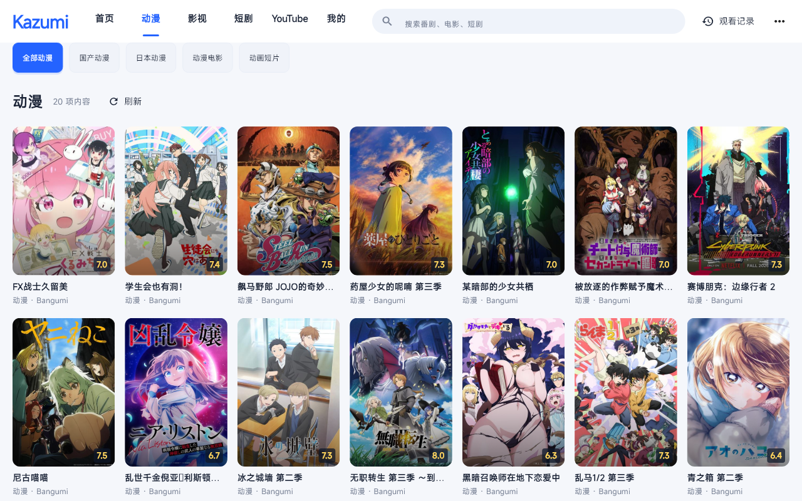

# Android 平板安装包

增强版的 Android 应用标识为 `io.github.jisongmuli.kazumi_enhanced`，显示名称为 Kazumi Enhanced。可与上游 Kazumi 同时安装，各自保存设置和历史。

## 编译

需要 Flutter 3.47.6、完整 JDK 17/21（包含 `jlink`）、Android SDK Platform 36、Build Tools 36、NDK 28.2.13676358 和 CMake 3.22.1。部分插件还需要 SDK Platform 31/33/34/35。SDK 路径通过 `ANDROID_HOME` 或未提交的 `android/local.properties` 配置。

```powershell
flutter pub get
flutter build apk --release --split-per-abi --target-platform=android-arm64 --build-name=2.3.8 --build-number=2030804
```

ARM64 输出为 `build/app/outputs/flutter-apk/app-arm64-v8a-release.apk`，最低 Android 7.0。发布构建应配置自己的固定签名，后续覆盖安装须使用同一私钥。将以下字段保存到本机 `android/key.properties`，或通过环境变量 `KAZUMI_KEYSTORE_PROPERTIES` 指向其他本机属性文件：

```properties
storeFile=你的签名文件完整路径
storePassword=你的密码
keyAlias=你的别名
keyPassword=你的密码
```

私钥与属性文件不进入仓库。未配置发布签名时沿用调试签名，适合开发验证；分发时请自行提供签名。

在 `flutter test` 或分析之后编译发布 APK 时，保留构建命令默认的依赖/平台工具刷新步骤，不加 `--no-pub`。Flutter 3.47 的测试注册文件可能包含开发专用原生插件，发布构建必须重新生成不包含它们的注册文件。

## 动漫栏目修订后的实际界面



图中为真实公开目录和封面的 Flutter 页面渲染，尚非 Android 平板实机截图。

## 功能与平台差异

- 新版主页、分类、影视目录、红果网页公开集数、跨站搜索、播放来源筛选、历史记录和原生视频播放使用共享代码。
- 平板修订版修复“动漫 0 项内容”：全部动漫使用公开热门缓存；缺少发布镜像凭据时，分类/搜索使用官方 ECH 连接。镜像未提供的详情接口也会回退到官方 ECH。保留真实筛选、分页与取消行为。
- 首次加载使用封面骨架屏；刷新保留已有内容；成功读取的动漫目录最多缓存 24 份、保存 7 天，离线回退有明确提示。导航、分类、卡片和入场动画遵循系统“减少动画”；轮播进入后台暂停。
- 已收录的影视站在 Android 上同样参与播放来源检索；是否可读取取决于站点网络、验证和页面结构。
- 首次安装导入 16 条公开动漫规则，加上 45 个影视/短剧站入口，共 61 条内置检索来源。来源和快照见 [内置规则说明](BUNDLED_RULES.md)，不会把电脑上的私人规则、Cookie 或历史打进 APK。
- YouTube 的 Windows yt-dlp / Node 组件不包含在 APK 中；Android 页面提供“打开 YouTube”，在外部浏览器观看并使用 YouTube 提供的画质选项。
- Windows RIFE / VapourSynth 组件不包含在 APK 中；AI 算法不可选。普通光流依赖 Android 播放器及 CPU 性能，未生效时会显示实际检测结果，可以关闭。
- Android 默认弹幕直接读取哔哩哔哩公开番剧目录、分集和整集分段弹幕，无需 AppId / AppSecret 或电脑服务；未知时长时读取公开 XML 弹幕池。手动搜索后选择番剧和集数；自动匹配按实际集号，预告和花絮不会挤占正片集号。此来源覆盖哔哩哔哩的公开内容；“设置 → 弹幕接口”仍可填写兼容服务或自己的官方凭据来使用其他来源。内置源保留弹幕原文，繁简转换由支持它的兼容/官方接口处理。本机 Windows Node 弹幕服务不包含在 APK 中。
- APK 不包含桌面端的播放历史、网站 Cookie、弹幕凭据、签名私钥或 Windows 可执行组件。

把 ARM64 APK 传到平板，点击文件并按系统提示允许此次来源安装。若使用兼容服务或代理，需要在平板上单独配置；电脑上的本地代理地址不能直接用于平板。

默认弹幕的显式联网验证：`flutter test --no-pub tools/mobile_danmaku_live_test.dart`，设置 `KAZUMI_VERIFY_DIR` 保存搜索、分集数量和弹幕时间范围报告；主机验证不代替 Android 实机复核。
